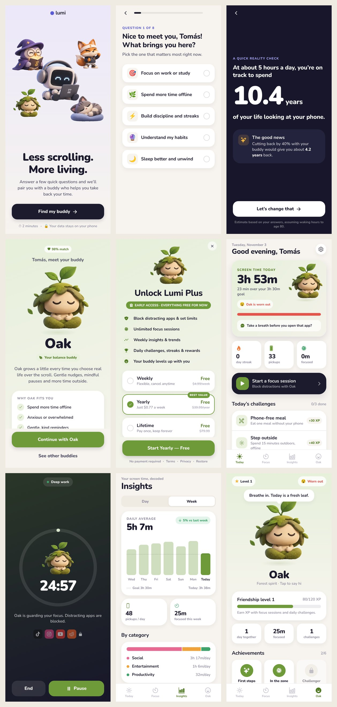

# Lumi — your screen-time buddy

An iOS-first Expo / React Native app. You answer a short quiz, get matched with one of five buddies (Byte, Oak, Volt, Sage, Momo), and that buddy helps you cut screen time through focus sessions, daily challenges, insights and a friendship level that grows as you go.



## Run it

```bash
npm install
npx expo start          # press i for the iOS simulator, or scan the QR code with Expo Go
npx expo start --web    # quick preview in a browser
```

## What's in it

| Area | Screens |
|---|---|
| Onboarding | Welcome → name → 8-question quiz → "years on your phone" reality check → matching animation → buddy reveal (or pick another buddy) → daily goal → permissions → paywall |
| Today | Live screen time vs goal, buddy mood, streak, pickups, focus CTA, 3 daily challenges per buddy (XP), most-used apps |
| Focus | Duration and mode picker, blocked apps, full-screen timer (pause, end with confirm, strict mode), completion reward |
| Insights | Day and week views, goal line, change vs last week, categories, buddy tips, per-app usage |
| Buddy | Tap to pet, friendship level and XP, achievements, switch buddy |
| Settings | Name, goal, limits, notifications, wind-down/bedtime, strict mode, haptics, invite, reset |

## Key files

- `src/data/mascots.ts`: buddy personalities, colors, lines and challenges
- `src/data/quiz.ts` + `src/lib/match.ts`: quiz questions and the weighted scoring that picks the buddy
- `src/data/plans.ts`: paywall plans. `FREE_EARLY_ACCESS = true` makes all 3 plans free. Set it to `false` and connect RevenueCat/StoreKit to start charging.
- `src/lib/usage.ts`: **simulated** Screen Time data. Real data needs Apple's FamilyControls/DeviceActivity entitlement and native extensions. Every screen reads from this one module, so a native provider can replace it later without touching the screens.
- `src/theme/tokens.ts`: colors, type ramp (Nunito), spacing, radii, shadows
- `.claude/skills/ios-design-md`: iOS DESIGN.md reference library (Expo flavors) from meliwat/awesome-ios-design-md

## Before the App Store

1. Apply for the Family Controls entitlement, then add a native Screen Time module (config plugin plus DeviceActivity extension) behind `src/lib/usage.ts`.
2. Add real notifications (`expo-notifications`) where the permission screen and settings currently only flip a flag.
3. Hook up purchases and turn off `FREE_EARLY_ACCESS` when you're ready to charge.
4. Replace the app icon and splash in `assets/`, then run `npx eas-cli@latest build -p ios`.
